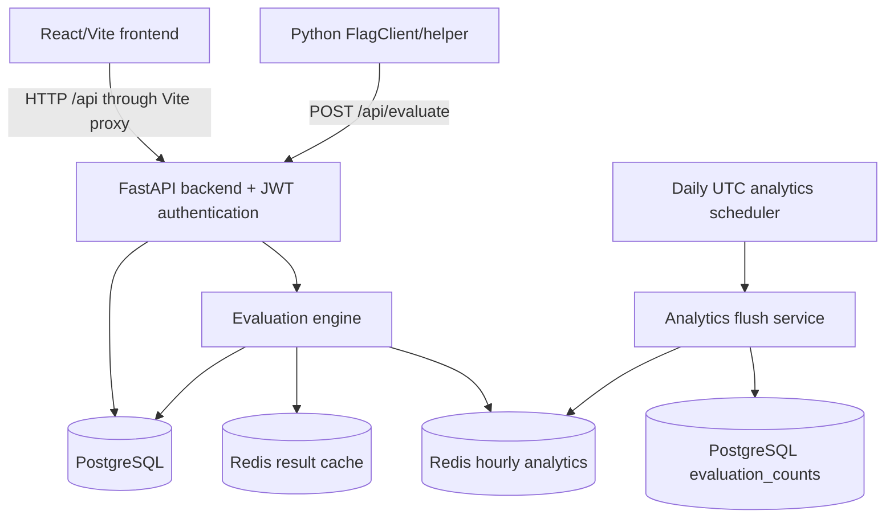
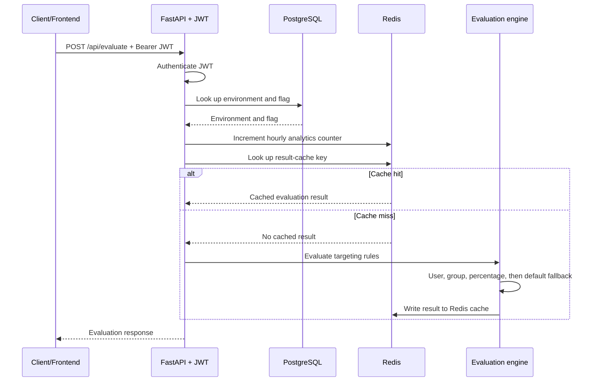

# FlagFlow Architecture and Data Flow

## System architecture

FlagFlow consists of a React/Vite administration frontend and an authenticated
FastAPI backend. The backend stores configuration and persisted analytics in
PostgreSQL and uses Redis for evaluation-result caching and hourly evaluation
counters. The Python `FlagClient` is an optional helper for applications that
call the evaluation API. A FastAPI lifecycle task runs the daily analytics
flush.



The frontend uses the Vite development proxy to forward `/api` requests to
FastAPI at `127.0.0.1:8000`. The Python helper has its own optional in-memory
cache; it is separate from the server-side Redis cache.

## Feature-flag evaluation flow



The analytics increment is best effort and does not change the evaluation
response when Redis is unavailable. A cache hit returns the cached decision
with the message `Returned From Redis Cache`; environment and flag lookup and
the analytics increment still occur before the cache lookup.

## Data stores

### PostgreSQL

PostgreSQL contains durable application data:

- environments;
- feature flags and flag versions;
- targeting rules and group memberships;
- audit logs;
- persisted hourly evaluation aggregates in `evaluation_counts`.

SQLAlchemy sessions are created for API requests. The scheduled analytics flush
uses a short-lived session for each run.

### Redis

Redis contains operational, non-authoritative runtime data:

- evaluated result-cache entries;
- hourly evaluation counters.

Result-cache keys have the form:

```text
flag:<environment_name>:<flag_key>:<sha256(canonical_user_context)>
```

Hourly analytics counters use Redis hashes with keys:

```text
analytics:evaluations:<YYYYMMDDHH>
```

Each hash field is:

```text
<environment_id>:<flag_id>
```

and its value is the evaluation count for that UTC hour.

## Targeting and cache behavior

Targeting uses fixed type precedence:

1. User rules
2. Group rules
3. Percentage rules
4. Default flag state

Within each type, lower priority numbers are evaluated first. Equal priorities
are resolved by ascending database rule ID. Only active rules participate, and
the first matching rule wins.

After a committed flag or targeting-rule mutation, the relevant result-cache
entries are invalidated by scanning the flag's cache-key namespace. Redis
invalidation is best effort; a Redis failure is logged and does not turn a
successful PostgreSQL mutation into an API failure.

Evaluation cache reads and writes are also bounded by the configured Redis
timeouts. Redis analytics failures are logged and do not propagate into flag
evaluation failures.

## Daily analytics flush

The FastAPI lifespan starts an asynchronous scheduler. At the start of each UTC
day it creates a fresh database session and calls the existing flush service.
Completed Redis hourly buckets are written to `evaluation_counts`; existing
rows are overwritten with the bucket's authoritative count, making retries
idempotent. A bucket is deleted only after successful PostgreSQL persistence.
Database failures retain the Redis bucket for retry, and the session is closed
after every scheduled run.

## Runtime topology

The current project is run as separate local processes:

```text
Browser or Python client
        |
        v
Vite development server :5173
        |
        v
FastAPI/Uvicorn :8000
        |                 \
        v                  v
PostgreSQL              Redis :6379
```

PostgreSQL and Redis are external services configured through environment
settings. The repository does not define Docker Compose, Kubernetes, or a
production deployment topology.

## Known limitations

- Redis is an optimization and telemetry dependency; evaluation and mutation
  paths continue with bounded or best-effort behavior when Redis operations
  fail.
- The scheduled flush is started by each FastAPI application lifespan; the
  project does not provide a distributed scheduler or cross-process lock.
- SQLAlchemy engine configuration currently leaves pool sizing at its default
  and enables SQL echo logging.
- The Python `FlagClient` is a repository helper, not a separately packaged
  multi-language SDK.
- Runtime evaluation is authenticated and is not an anonymous public endpoint.
